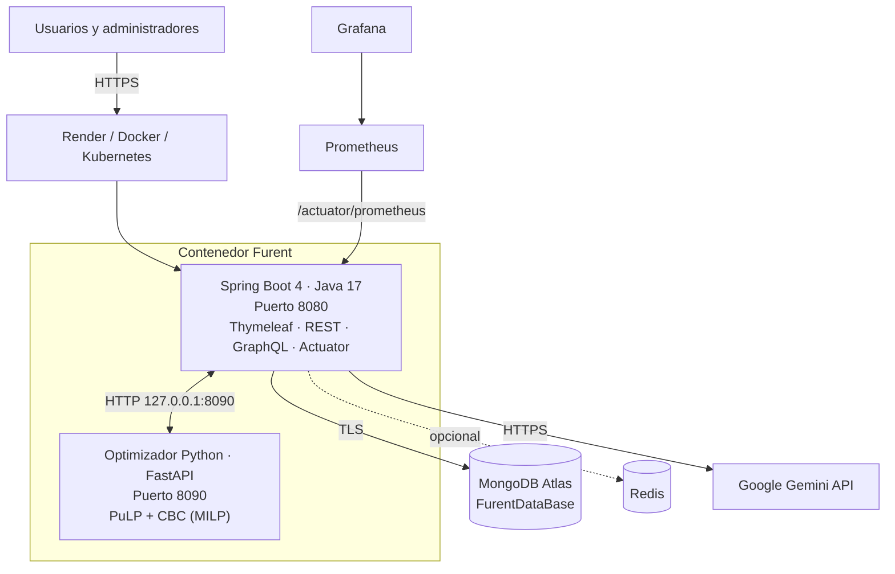

<p align="center">
  
</p>

<h1 align="center">FURENT</h1>

<p align="center">
  Plataforma SaaS de alquiler de mobiliario para eventos: catálogo, reservas, pagos, logística, analítica, optimización matemática y asistente con IA.
</p>

<p align="center">
  <a href="https://furent-alquiler.onrender.com"></a>
  <a href="https://github.com/realgzzy/Furent-Alquiler"></a>
  
  
  
  
  <a href="LICENSE"></a>
</p>

<p align="center">
  <a href="#-qué-es-furent">Qué es</a> ·
  <a href="#-stack-tecnológico">Stack</a> ·
  <a href="#-arquitectura">Arquitectura</a> ·
  <a href="#-módulos-y-rutas">Módulos</a> ·
  <a href="#-inicio-rápido">Inicio rápido</a> ·
  <a href="#-despliegue">Despliegue</a> ·
  <a href="#-documentación">Docs</a>
</p>

---

## 🪑 Qué es Furent

Furent es una aplicación web completa para una empresa de alquiler de mobiliario de eventos (sillas, mesas, carpas, cristalería y decoración). Cubre el ciclo de negocio de punta a punta:

- **Cliente:** explorar catálogo y combos, cotizar, reservar, pagar en línea, gestionar su perfil, favoritos, notificaciones y reseñas.
- **Operación:** aprobar reservas, controlar stock, generar contratos y hojas de ruta, gestionar logística y pagos a trabajadores.
- **Gerencia:** dashboard ejecutivo, reportes, exportaciones, auditoría, cupones, mensajes y configuración del sitio.
- **Inteligencia:** optimización de inventario/flota con programación lineal entera mixta (MILP), modelo predictivo y asistente conversacional con Google Gemini.

El proyecto nació como trabajo académico y evolucionó a una arquitectura tipo **SaaS multi-tenant** con despliegue en la nube, observabilidad y CI/CD.

### Enlaces de producción

| Recurso | URL |
| :--- | :--- |
| Sitio en vivo | <https://furent-alquiler.onrender.com> |
| Catálogo | <https://furent-alquiler.onrender.com/catalogo> |
| Login | <https://furent-alquiler.onrender.com/login> |
| Panel administrativo | <https://furent-alquiler.onrender.com/admin> |
| Dashboard BI | <https://furent-alquiler.onrender.com/admin/bi> |
| Optimización (MILP) | <https://furent-alquiler.onrender.com/admin/optimizacion> |
| Landing estática (Firebase) | <https://furent-web.web.app> |

> [!NOTE]
> El plan gratuito de Render suspende el contenedor tras ~15 minutos de inactividad. La primera petición puede tardar entre 30 y 60 segundos; es comportamiento esperado de la capa gratuita, no un fallo de la aplicación.

---

## 🧰 Stack tecnológico

### Backend

| Componente | Versión / Detalle |
| :--- | :--- |
| Java | 17 |
| Spring Boot | 4.0.10 (`spring-boot-starter-parent`) |
| Spring Web MVC + Thymeleaf | Renderizado del lado del servidor |
| Spring Security | RBAC, CSRF, BCrypt, OAuth2, sesiones |
| Spring Data MongoDB | Persistencia principal |
| Spring Data Redis + Cache | Caché distribuida opcional |
| Spring GraphQL | Esquema en `src/main/resources/graphql/schema.graphqls` |
| Spring Actuator + Micrometer | Health, métricas y Prometheus |
| Springdoc OpenAPI | Documentación interactiva de la API |
| Logback + Logstash encoder | Logs estructurados en producción |
| JWT (JJWT) | Access y refresh tokens para la API |
| Maven Wrapper | `mvnw` / `mvnw.cmd` |

### Frontend

| Componente | Detalle |
| :--- | :--- |
| Thymeleaf | Plantillas server-side (`src/main/resources/templates`) |
| Tailwind CSS | 3.4.17, dos builds separados (público y admin) |
| Alpine.js | Interactividad ligera |
| AOS | Animaciones al hacer scroll |
| SweetAlert2 | Diálogos y confirmaciones |
| Inter + Dancing Script | Tipografías |

### Datos, IA y operaciones

| Componente | Detalle |
| :--- | :--- |
| MongoDB | Base de datos principal (`FurentDataBase`) |
| Redis | Caché opcional (en producción se usa caché en memoria) |
| FastAPI + Uvicorn | Microservicio optimizador en Python |
| PuLP + CBC | Solver MILP de investigación de operaciones |
| Google Gemini | Asistente conversacional con streaming SSE |
| Weka J48 | Modelo predictivo de reservas |
| Prometheus + Grafana | Observabilidad (stack de Docker Compose) |

---

## 🏛️ Arquitectura

Monolito modular Spring Boot que expone vistas Thymeleaf y una API REST/GraphQL. El contenedor de producción incluye además un microservicio Python que resuelve el modelo de optimización y se consume por HTTP en `127.0.0.1:8090`.



### Capas del código

```
com.alquiler.furent
├── config        Seguridad, caché, CORS, tenants, rate limit, métricas, OpenAPI
├── controller    Vistas públicas, panel admin y API REST
├── service       Lógica de negocio, pagos, PDF, email, IA, optimización
├── repository    Repositorios Spring Data MongoDB
├── model         Entidades y documentos
├── dto           Contratos de entrada/salida
├── enums         Estados, roles, tipos
├── assistant     Orquestador, tools, prompts y cliente Gemini
├── scheduler     Tareas programadas
├── event         Eventos de dominio
├── exception     Manejo global de errores
└── util          Utilidades
```

---

## 🧭 Módulos y rutas

### Sitio público

| Ruta | Descripción |
| :--- | :--- |
| `/` | Landing principal |
| `/catalogo` | Catálogo de mobiliario con filtros y búsqueda |
| `/producto/{id}` | Detalle de producto |
| `/combo/{id}` | Detalle de combo/paquete |
| `/inspiracion` | Galería de inspiración con pines interactivos |
| `/nosotros` | Información de la empresa |
| `/contacto` | Formulario de contacto |
| `/faq` | Preguntas frecuentes |
| `/cotizacion` | Cotizador y flujo de reserva |
| `/login`, `/registro`, `/inicio-rapido` | Autenticación y acceso rápido |
| `/panel` | Panel del cliente |
| `/configuracion` | Perfil, direcciones, contraseña, 2FA y sesiones |
| `/pago/tarjeta`, `/pago/resultado` | Pago y resultado de la transacción |
| `/password-reset` | Recuperación de contraseña |

> El catálogo público (`/`, `/catalogo`, `/producto/**`, etc.) es accesible sin sesión. El panel del cliente, la cotización y la configuración requieren autenticación.

### Panel administrativo (`/admin/**`, rol `ADMIN`)

| Ruta | Módulo |
| :--- | :--- |
| `/admin` | Dashboard general |
| `/admin/bi` | Business Intelligence y KPIs |
| `/admin/reservas` | Reservas, estados, abonos y contratos PDF |
| `/admin/mobiliarios` | Productos, stock y combos |
| `/admin/categorias` | Categorías del catálogo |
| `/admin/logistica` | Despachos y hojas de ruta |
| `/admin/pagos` | Confirmación de pagos |
| `/admin/pagos-trabajadores` | Nómina de trabajadores y comprobantes |
| `/admin/cupones` | Cupones de descuento |
| `/admin/usuarios` | Usuarios, roles y estados |
| `/admin/mensajes` | Mensajes de contacto y reseñas |
| `/admin/inspiracion` | Gestión de la galería y sus pines |
| `/admin/asistente` | Conversaciones del asistente IA |
| `/admin/optimizacion` | Optimización MILP de inventario y flota |
| `/admin/predicciones` | Modelo predictivo |
| `/admin/exportar` | Exportación CSV de productos, reservas y usuarios |

### API REST

| Prefijo | Contenido |
| :--- | :--- |
| `/api/auth` | Login, registro, refresh, logout y usuario actual |
| `/api/productos` | Búsqueda, disponibilidad y stock |
| `/api/favoritos` | Alta y baja de favoritos |
| `/api/cupones` | Validación de cupones |
| `/api/notificaciones` | Listado y marcado de leídas |
| `/api/cotizacion` | Cotización e inicio de pago |
| `/api/pagos` | PayU, pagos pendientes y consulta por reserva |
| `/api/asistente` | Chat y conversaciones del asistente IA |

Además, `POST /graphql` expone el esquema GraphQL (`ping` como consulta base) y la documentación interactiva está disponible en `/swagger-ui/index.html`.

---

## 🧮 Motor de optimización (Investigación de Operaciones)

Ubicado en `python/optimizer/` y consumido desde `/admin/optimizacion` mediante `PythonOptimizerClient`.

### Modelo MILP

Programación Lineal Entera Mixta resuelta con **PuLP + CBC**. Decide qué reservas aceptar, cuánto inventario adicional comprar, el valor de escasez de cada recurso (precio sombra) y dónde se satura el inventario por producto y fecha.

```
max  Z = Σ R_i·z_i − Σ c_p·y_p − M·Σ s_{p,t}

s.a.  Σ_{i∈(p,t)} q_ip·z_i − s_{p,t} ≤ S_p + y_p     ∀ p, t
      z_i = 1                                        reservas comprometidas
      z_i ∈ {0,1}                                    reservas candidatas
      y_p ∈ Z≥0 ,  y_p ≤ tope
      s_{p,t} ≥ 0
```

- `R_i`: ingreso de la reserva · `S_p`: stock propio · `c_p`: coste de una unidad extra
- `y_p`: unidades extra adquiridas · `q_ip`: cantidad del producto en la reserva
- `s_{p,t}`: unidades-día comprometidas sin cubrir (penalizadas con `M`)

La respuesta incluye `objective`, `accepted`, `rejected`, `utilization`, `purchases`, `shadowPrices`, `heatmap`, `baseline` e `improvement`. Si el servicio no está disponible, la web muestra un error claro y **no** aplica heurísticas alternativas: el modelo siempre se resuelve en Python.

### Endpoints del optimizador

| Método | Ruta | Descripción |
| :--- | :--- | :--- |
| `GET` | `/health` | Estado del servicio |
| `POST` | `/optimize` | Resuelve el modelo con el payload de entrada |

```bash
# Desde python/optimizer
python -m venv .venv
# Windows
.\.venv\Scripts\python.exe -m pip install -r requirements.txt
.\.venv\Scripts\python.exe -m uvicorn app:app --host 127.0.0.1 --port 8090
# Linux/macOS
source .venv/bin/activate && pip install -r requirements.txt
uvicorn app:app --host 127.0.0.1 --port 8090
```

La URL se configura con `furent.optimizer.base-url` o la variable `OPTIMIZER_URL` (por defecto `http://127.0.0.1:8090`).

---

## 📊 Analítica, predicción y asistente IA

- **Business Intelligence (`/admin/bi`):** dashboard ejecutivo con KPIs de facturación, contratos, ticket promedio, conversión y satisfacción. Modelo dimensional tipo estrella (`Fact_Reservas` + dimensiones de cliente, mobiliario, fecha, ubicación y categoría).
- **Predicciones (`/admin/predicciones`):** modelo de árboles de decisión **Weka J48** para anticipar comportamiento de reservas.
- **Asistente (`/api/asistente`, `/admin/asistente`):** chat con Google Gemini, streaming SSE, herramientas internas, base de conocimiento (`classpath:assistant/knowledge.yml`), cuotas por invitado/usuario y presupuesto diario. Se activa con `ASSISTANT_ENABLED=true` y `GEMINI_API_KEY`.
- **Reportes y exportación:** CSV de productos, reservas y usuarios; PDF de contratos, hojas de ruta y pagos a trabajadores.

---

## 🗄️ Modelo de datos

Base de datos MongoDB `FurentDataBase`. Principales colecciones:

| Colección | Propósito |
| :--- | :--- |
| `reservas` | Órdenes de alquiler, fechas, ítems y estados |
| `mobiliarios` / `productos` | Catálogo, stock total y disponible, precios |
| `categorias` | Clasificación del catálogo |
| `combos` | Paquetes de productos con descuento |
| `usuarios` | Clientes y administradores (BCrypt) |
| `tenants` | Configuración multi-empresa |
| `permissions` | Permisos RBAC |
| `audit_logs` | Auditoría inmutable de acciones críticas |
| `pagos` / `pending_card_payments` | Transacciones PayU y pagos pendientes |
| `cupones` | Descuentos con vigencia y límite de usos |
| `reviews` | Reseñas y calificaciones |
| `notificaciones` | Alertas del sistema |
| `analytics_events` | Telemetría de eventos |
| `asistente_conversaciones` / `asistente_mensajes` | Historial del asistente IA |
| `refresh_tokens` / `password_reset_tokens` | Seguridad de sesiones |
| `worker_payments` | Pagos a trabajadores |

Los índices se crean automáticamente (`spring.data.mongodb.auto-index-creation=true`) y `DataInitializer` siembra los datos base (admin, tenant, permisos y catálogo demo) al arrancar.

---

## 🔐 Seguridad

- **Spring Security** con RBAC (`ADMIN`, `USER`) y protección CSRF.
- **BCrypt** para contraseñas y **JWT** (access + refresh) para la API.
- **OAuth2 con Google** (`/login/oauth2/code/google`).
- **2FA TOTP** configurable desde `/configuracion/2fa/setup`.
- **Rate limiting** por IP (deshabilitado en `dev`, configurable en `prod`).
- **Auditoría** de autenticación y acciones críticas (`AuditLogService`).
- **Multi-tenant** por `TenantFilter` + `TenantContext`.
- **Cabeceras de seguridad** y compresión en producción.

> [!IMPORTANT]
> No subas secretos al repositorio. Usa variables de entorno o `application-local.properties` (ignorado por Git) para credenciales locales. Rota cualquier clave que haya estado expuesta.

---

## 📁 Estructura del repositorio

```
Furent-Alquiler/
├── src/main/java/com/alquiler/furent/   Código Java (config, controller, service, model, …)
├── src/main/resources/
│   ├── templates/                       Vistas Thymeleaf (público, admin, emails, errores)
│   ├── static/                          CSS compilado, JS, imágenes
│   ├── css/tailwind.src.css             Fuente de Tailwind
│   ├── assistant/knowledge.yml          Base de conocimiento del asistente
│   ├── graphql/schema.graphqls          Esquema GraphQL
│   └── application*.properties          Configuración por perfil
├── src/test/                            Tests unitarios y de integración
├── python/optimizer/                    Microservicio FastAPI + PuLP/CBC
├── scripts/                             Scripts de desarrollo y OAuth
├── docs/                                Documentación técnica y de negocio
├── k8s/                                 Manifiestos Kubernetes
├── monitoring/                          Configuración de Prometheus
├── public/                              Landing estática para Firebase Hosting
├── .github/workflows/                   CI y CD
├── pom.xml                              Dependencias Maven
├── package.json                         Build de Tailwind
├── Dockerfile                           Imagen multi-stage (Java + Python)
├── docker-compose.yml                   Stack local completo
├── docker-entrypoint.sh                 Arranque del contenedor
├── render.yaml                          Blueprint de Render
├── firebase.json                        Configuración de Firebase Hosting
├── .env.example                         Variables de entorno de ejemplo
└── README.md
```

---

## 🚀 Inicio rápido

### Requisitos

- **JDK 17**
- **Node.js 18+** (solo para compilar Tailwind)
- **MongoDB** local o una cadena de MongoDB Atlas
- **Python 3.10+** (solo para el optimizador)
- Opcional: Docker y Docker Compose

### 1. Clonar e instalar dependencias

```bash
git clone https://github.com/realgzzy/Furent-Alquiler.git
cd Furent-Alquiler

# Dependencias Java (se descargan al compilar)
./mvnw -q -DskipTests compile

# Dependencias de Tailwind
npm install
```

### 2. Compilar los estilos

```bash
npm run build:css          # público + admin
npm run watch:css:public   # modo watch (público)
npm run watch:css:admin    # modo watch (admin)
```

### 3. Configurar variables de entorno

```bash
cp .env.example .env
```

Edita `.env` con tu cadena de MongoDB, credenciales de Google OAuth y PayU. Para secretos puramente locales puedes usar `application-local.properties` en la raíz (ignorado por Git).

### 4. Arrancar

**Opción A — script todo-en-uno (Windows):**

```powershell
.\scripts\restart-app.ps1
```

Libera los puertos `8080` y `8090`, inicia el optimizador Python en segundo plano y luego Spring Boot.

**Opción B — manual:**

```bash
# Terminal 1: optimizador
cd python/optimizer
python -m venv .venv
.\.venv\Scripts\python.exe -m pip install -r requirements.txt
.\.venv\Scripts\python.exe -m uvicorn app:app --host 127.0.0.1 --port 8090

# Terminal 2: aplicación
./mvnw spring-boot:run
```

Abre <http://localhost:8080>. El perfil por defecto es `dev` (caché simple, sin Redis obligatorio).

**Opción C — Docker Compose (stack completo):**

```bash
docker compose up --build
```

Levanta la app, MongoDB, Redis, Prometheus y Grafana con volúmenes persistentes.

### 5. Credenciales iniciales

| Campo | Valor por defecto |
| :--- | :--- |
| Email admin | `admin@furent.com` |
| Contraseña | `admin123` (`ADMIN_PASSWORD`) |

> Cambia la contraseña en cualquier entorno que no sea local.

---

## ⚙️ Variables de entorno

| Variable | Descripción | Por defecto / dev | Producción |
| :--- | :--- | :--- | :--- |
| `PORT` | Puerto HTTP | `8080` | `8080` |
| `SPRING_PROFILES_ACTIVE` | Perfil de Spring | `dev` | `prod` |
| `MONGODB_URI` | Cadena de conexión MongoDB | `mongodb://localhost:27017/FurentDataBase` | Atlas (`mongodb+srv://…`) |
| `REDIS_HOST` / `REDIS_PORT` | Servidor Redis | `localhost` / `6379` | Opcional |
| `REDIS_PASSWORD` | Contraseña de Redis | vacío | Opcional |
| `CACHE_TYPE` | Tipo de caché | `simple` | `simple` |
| `CACHE_ENABLED` | Activar caché | `false` | `false` |
| `ADMIN_PASSWORD` | Contraseña del admin | `admin123` | Secreto |
| `JWT_SECRET` | Clave de firma JWT | valor de desarrollo | Secreto de 256 bits |
| `GOOGLE_CLIENT_ID` / `GOOGLE_CLIENT_SECRET` | OAuth2 Google | — | Credenciales reales |
| `PAYU_API_KEY` / `PAYU_MERCHANT_ID` / `PAYU_ACCOUNT_ID` | Pasarela PayU | Sandbox | Producción |
| `PAYU_URL` | URL de checkout PayU | Sandbox | Producción |
| `GEMINI_API_KEY` | API key de Google AI Studio | vacío | Secreto |
| `GEMINI_MODEL` | Modelo del asistente | `gemini-3.5-flash-lite` | Igual |
| `ASSISTANT_ENABLED` | Activar asistente | `false` (`dev`: `true`) | `true` con API key |
| `OPTIMIZER_URL` | URL del microservicio | `http://127.0.0.1:8090` | Igual |
| `INSPIRATION_UPLOAD_DIR` | Directorio de imágenes de inspiración | `uploads/inspiration` | Volumen persistente |

---

## 🛠️ Scripts disponibles

| Script | Plataforma | Uso |
| :--- | :--- | :--- |
| `scripts/restart-app.ps1` | Windows | Reinicia app + optimizador |
| `scripts/run-with-google-oauth.ps1` | Windows | Arranca con OAuth2 configurado |
| `scripts/run-with-google-oauth.sh` | Linux/macOS | Arranca con OAuth2 configurado |
| `scripts/setup-google-oauth.ps1` | Windows | Configura credenciales de Google |
| `scripts/setup-google-oauth.sh` | Linux/macOS | Configura credenciales de Google |
| `scripts/seed_users.py` | Multiplataforma | Siembra usuarios de prueba |

```powershell
# Windows
.\scripts\setup-google-oauth.ps1
.\scripts\run-with-google-oauth.ps1
```

```bash
# Linux/macOS
chmod +x scripts/*.sh
./scripts/setup-google-oauth.sh
./scripts/run-with-google-oauth.sh
```

---

## ☁️ Despliegue

### Render (producción actual)

El blueprint `render.yaml` define un servicio Docker en el plan gratuito, con healthcheck en `/login`, perfil `prod` y variables sensibles sincronizadas desde el panel. Cada push a `main` dispara un auto-deploy.

```bash
git pull origin main
git add .
git commit -m "feat(modulo): descripción del cambio"
git push origin main
```

### Docker

El `Dockerfile` es multi-stage:

1. **Build:** `eclipse-temurin:17-jdk-alpine` compila el JAR con Maven.
2. **Runtime:** `eclipse-temurin:17-jre-alpine` instala Python 3, copia el JAR y el optimizador, crea un usuario sin privilegios y arranca ambos procesos con `docker-entrypoint.sh`.

```bash
docker build -t furent/backend:latest .
docker run -p 8080:8080 --env-file .env furent/backend:latest
```

### Docker Compose

Incluye `app`, `mongo`, `redis`, `prometheus` y `grafana`, con healthchecks, volúmenes y red dedicada.

```bash
docker compose up --build -d
docker compose logs -f app
```

### Kubernetes

Manifiestos en `k8s/`: `namespace`, `configmap`, `secret`, `deployment` (2 réplicas, probes de salud y límites de recursos), `service` y `hpa` (2–10 réplicas por CPU/memoria).

```bash
kubectl apply -f k8s/namespace.yaml
kubectl apply -f k8s/configmap.yaml -f k8s/secret.yaml
kubectl apply -f k8s/deployment.yaml -f k8s/service.yaml -f k8s/hpa.yaml
```

### Firebase Hosting

`firebase.json` publica la landing estática de `public/` con cabeceras de seguridad.

```bash
firebase deploy --only hosting
```

---

## 📈 Observabilidad

| Recurso | Ruta |
| :--- | :--- |
| Health | `/actuator/health` |
| Info | `/actuator/info` |
| Métricas | `/actuator/metrics` |
| Prometheus | `/actuator/prometheus` |
| Cachés | `/actuator/caches` |

`monitoring/prometheus.yml` hace scraping de `/actuator/prometheus` cada 15 segundos. En producción los logs se emiten en JSON estructurado mediante `logback-spring.xml` + Logstash encoder.

---

## 🔁 CI/CD

| Workflow | Disparador | Acciones |
| :--- | :--- | :--- |
| `.github/workflows/ci.yml` | Push a `main`/`develop`, PR a `main` | JDK 17, `mvnw package`, tests, artefacto JAR y build Docker |
| `.github/workflows/ci-cd.yml` | Pipeline de integración y despliegue | Build, pruebas y publicación de imagen |

---

## 🧪 Tests

```bash
./mvnw test
```

La suite cubre seguridad, servicios, controladores, flujo completo de reservas, cupones, pagos, email, JWT, tenants y el módulo de asistente (cliente Gemini, parser SSE, orquestador, tools y cuotas).

---

## 🤝 Convenciones de trabajo

1. **Sincroniza antes de tocar código:** `git pull origin main`.
2. **La rama de despliegue es `main`:** Render solo publica desde ahí.
3. **No rompas flujos existentes:** verifica dependencias antes de modificar módulos funcionales.
4. **Saltos de línea:** los `*.sh` deben usar **LF**; los `*.cmd`, **CRLF** (ver `.gitattributes`).
5. **Tema claro/oscuro:** toda pantalla nueva debe funcionar en ambos.
6. **Secretos fuera del repo:** usa variables de entorno o `application-local.properties`.
7. **Estilo de commits:** `feat(modulo): …`, `fix(modulo): …`, `chore(area): …`.

---

## 📚 Documentación

| Documento | Contenido |
| :--- | :--- |
| [`docs/ARCHITECTURE.md`](docs/ARCHITECTURE.md) | Arquitectura detallada |
| [`docs/UML_DIAGRAMS.md`](docs/UML_DIAGRAMS.md) | Diagramas UML |
| [`docs/RESERVATION_FLOW.md`](docs/RESERVATION_FLOW.md) | Flujo de reservas |
| [`docs/MODELO_PREDICTIVO.md`](docs/MODELO_PREDICTIVO.md) | Modelo predictivo |
| [`docs/GOOGLE_OAUTH2_SETUP.md`](docs/GOOGLE_OAUTH2_SETUP.md) | Configuración de Google OAuth2 |
| [`docs/INICIO_RAPIDO_GOOGLE_OAUTH.md`](docs/INICIO_RAPIDO_GOOGLE_OAUTH.md) | Inicio rápido con OAuth2 |
| [`docs/OAUTH2_ARCHITECTURE.md`](docs/OAUTH2_ARCHITECTURE.md) | Arquitectura de autenticación |
| [`docs/ROADMAP_FURENT_10-10.md`](docs/ROADMAP_FURENT_10-10.md) | Hoja de ruta |
| [`docs/INFORME_ESTRATEGICO_VALOR_COMERCIAL_2026-03.md`](docs/INFORME_ESTRATEGICO_VALOR_COMERCIAL_2026-03.md) | Informe estratégico |
| [`python/optimizer/README.md`](python/optimizer/README.md) | Modelo MILP y contrato del optimizador |

---

## 👥 Equipo

| Integrante | Contacto |
| :--- | :--- |
| Luis Troconis | [@Ldtro](https://github.com/Ldtro) |
| Jose Valdes | — |
| Neyder Arjodiz | — |

Repositorio oficial: [realgzzy/Furent-Alquiler](https://github.com/realgzzy/Furent-Alquiler)

---

## 📜 Licencia

Distribuido bajo la **Licencia MIT**. Consulta el archivo [LICENSE](LICENSE) para más detalles.

<p align="center">
  Hecho con ☕ Java, 🐍 Python y 🍃 MongoDB.
</p>
